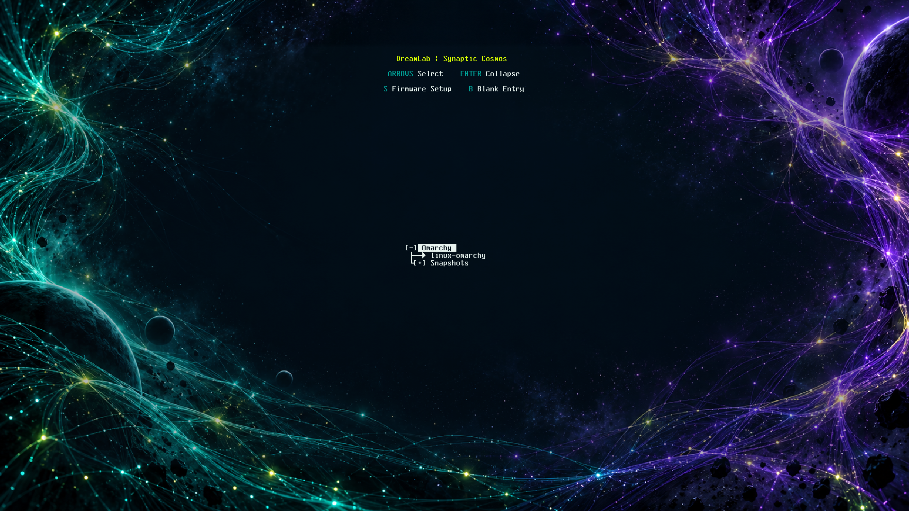

# DreamLab Boot Themes

Four space and AI inspired themes for **GRUB** and **Limine**, with an interactive
terminal installer, image previews, verified backups and conservative restore.
Teal, purple and acid yellow `#D9FF00` are the DreamLab palette.

[Download v0.5.1 preview](https://github.com/DreamLab-Solutions/dls-neon-grub/releases/tag/v0.5.1)
· [Installation](docs/INSTALLER.md) · [Theme gallery](docs/THEMES.md)
· [Compatibility](docs/COMPATIBILITY.md) · [Changelog](docs/CHANGELOG.md)
· [Italiano](docs/it/README.md)



*Synaptic Cosmos in the real Limine UEFI renderer, captured in an isolated VM.
Menu entries are demonstrations; the screenshot is not an OS boot test.*

## Install

Use the **combined installer** for guided theme choice and previews on either
supported bootloader. Download these two assets from the release page:

- `dls-neon-setup-0.5.1.tar.gz`
- `SHA256SUMS`

In the directory containing both downloads:

```sh
sha256sum --check --ignore-missing SHA256SUMS
tar -xzf dls-neon-setup-0.5.1.tar.gz
cd dls-neon-setup-0.5.1
python3 dls-neon-setup
```

Continue only when the archive reports **OK**. Run the console as your normal
user; it requests sudo for system inspection and confirmed writes. Choose **1–4**,
press **p** for a preview, **v** to review the plan, and **a** to apply. **r** restores
the previous appearance; **q** exits. The current console uses Italian prompts:
answer **s** to confirm recovery readiness, then type **APPLICA** or **RIPRISTINA**
when requested. The [installation guide](docs/INSTALLER.md) explains every step.

Requirements: Linux booted through the target GRUB/Limine in x86-64 UEFI mode,
Python 3.11 or newer, sudo, efibootmgr and util-linux tools. Existing GRUB
installations also need their native probe, path and syntax-check utilities.
`xdg-open` is optional for opening images. **Docker is only for development.**

Have a verified independent backup and a boot-tested UEFI live USB before applying.
The installer does not reboot; check the next real boot yourself.

## Choose your package

| Release asset | Who it is for |
| --- | --- |
| `dls-neon-setup-0.5.1.tar.gz` | Recommended: terminal chooser, all four themes and GRUB/Limine previews. |
| `dls-neon-grub_0.5.1_all.deb` | Debian/Ubuntu GRUB users who prefer the manager CLI; package installation only stages files. |
| `dls-neon-grub-0.5.1.tar.gz` | Portable GRUB manager and themes; manual CLI workflow. |
| `dls-neon-limine-0.5.1.tar.gz` | Dedicated Limine manager, themes and backup helper; manual CLI workflow. |
| `SHA256SUMS` | SHA-256 checksums for all four downloadable packages. |

The `.deb` and dedicated archives do not include the interactive chooser.
GitHub's automatically generated **Source code** archives are for contributors;
they are not the ready-to-run installer. Previews are included in the combined
archive and work offline. Docker images, QEMU, firmware, bootloader binaries and
personal backup/configuration reports are not runtime downloads.

This is a **preview release**. The repository is currently private, so release
downloads require access to it. The packages are prepared for distribution;
repository visibility and reference-material clearance are separate decisions.

## Themes

| Choice | Theme | Composition |
| --- | --- | --- |
| 1 | Event Horizon | Original portal artwork; left-aligned GRUB menu. |
| 2 | Quantum Fabric | Technological fabric with a dark central menu area. |
| 3 | Sentient Atlas | AI and cosmic structures framing the central menu. |
| 4 | Synaptic Cosmos | Teal/purple neural universe; default console selection. |

See [all four themes in both bootloaders](docs/THEMES.md). GRUB and Limine retain
their own native interface and typography; the same background produces different
menu layouts.

## Compatibility and multiboot

The combined installer qualifies the **active bootloader**, not the distribution
name. Standard GRUB/grub2 layouts are supported; Limine is restricted to the exact
qualified **12.8.0** EFI build and layout. Start with the
[compatibility matrix](docs/COMPATIBILITY.md), especially on other distributions.

Existing Windows, macOS/OpenCore, Linux, recovery, snapshot and custom entries are
preserved. Applying a theme does not discover or add missing operating systems.
Native Windows Boot Manager and Apple boot screens cannot use these themes.

GRUB retains the complete original configuration and appends graphics commands;
Limine retains its entire entry section. Restore checks for later changes before
writing. See [recovery and removal](docs/RECOVERY.md).

## Documentation and contributing

- [Install, choose a theme and restore](docs/INSTALLER.md)
- [GRUB CLI and Debian package](docs/GRUB.md)
- [Limine CLI and Omarchy notes](docs/OMARCHY.md)
- [Compatibility and known limits](docs/COMPATIBILITY.md)
- [Build and test](docs/DEVELOPMENT.md), [release process](docs/RELEASE.md)
- [Validation evidence](docs/VALIDATION.md), [Limine hardware scope](docs/VALIDATION-OMARCHY.md)
- [Design and artwork provenance](docs/DESIGN.md)

Maintained by [DreamLab Solutions](https://github.com/DreamLab-Solutions).
Code and documentation: [MIT](LICENSE-MIT). Runtime artwork:
[CC BY 4.0 where applicable](ARTWORK-LICENSE.md). DejaVu fonts retain their own
license; DreamLab marks are reserved. See [component licensing](LICENSE).
