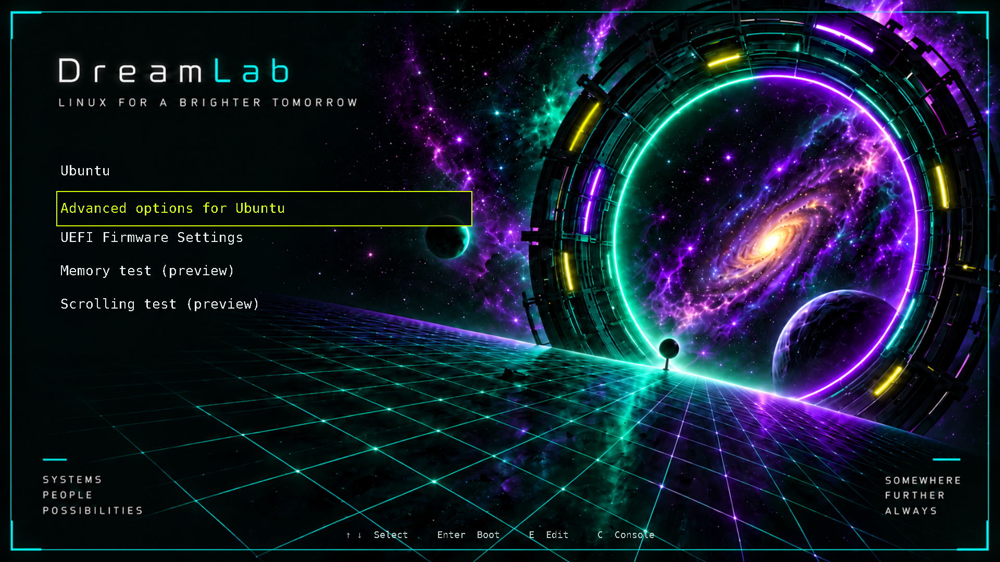
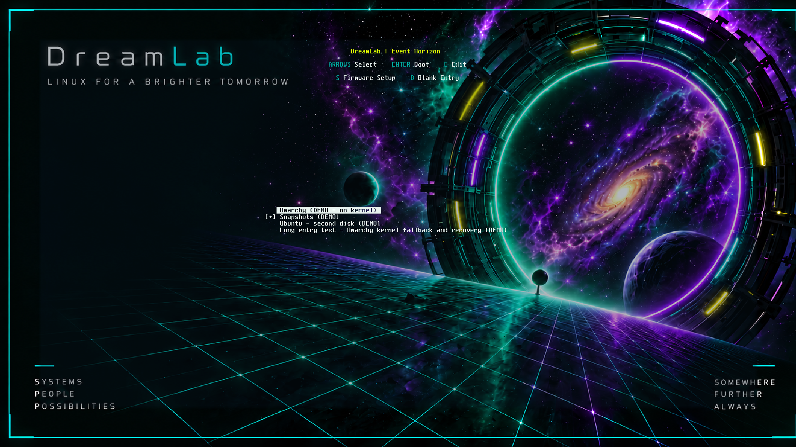
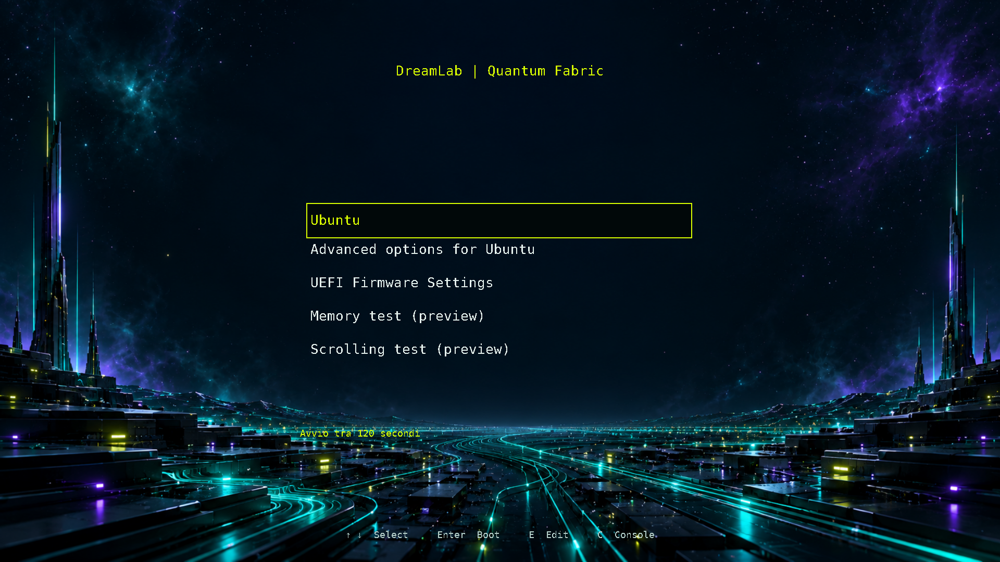
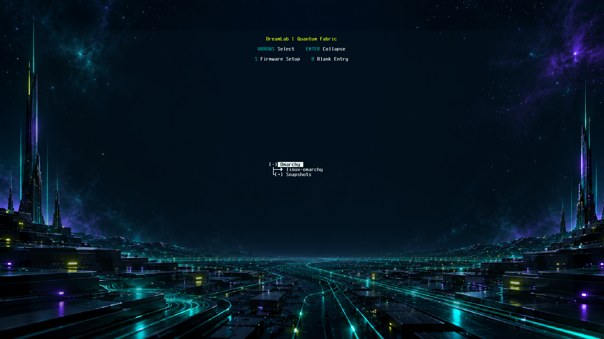
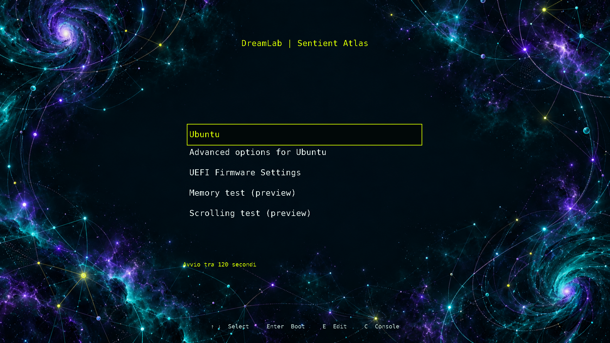
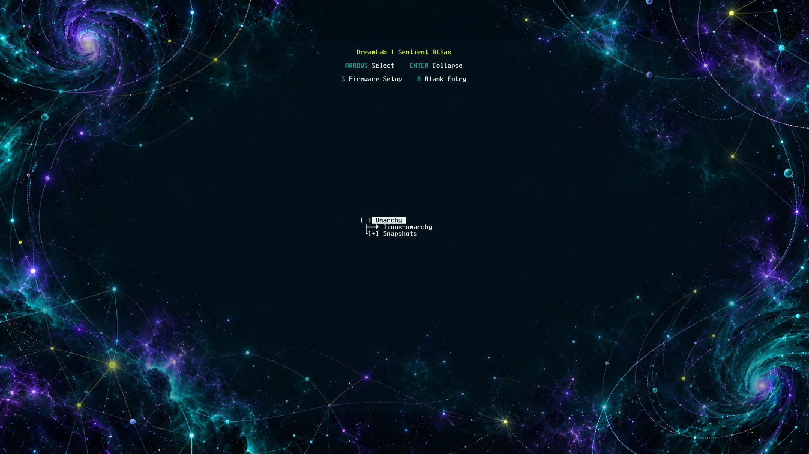
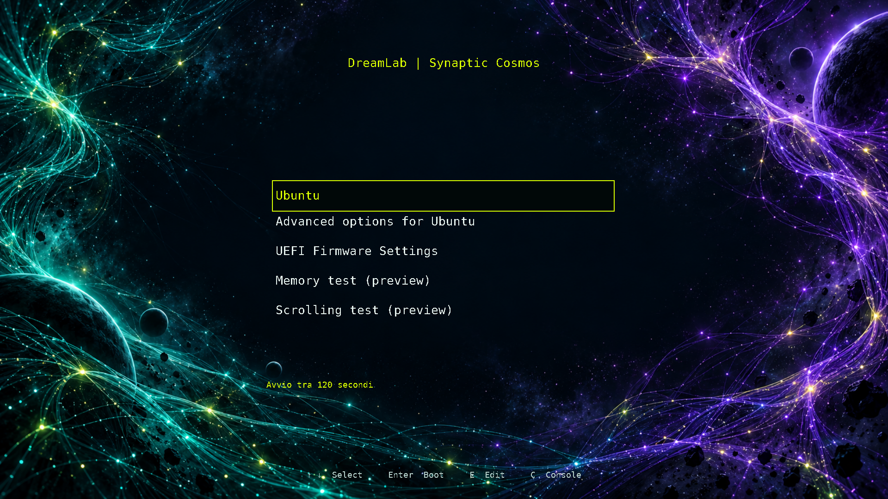

# Theme gallery

All images below are captures from real GRUB or Limine UEFI renderers in isolated
VMs. The menus use demo boot paths. They show appearance and navigation, not
successful operating-system boots. The same four choices are in every release
package; the combined console defaults to **4 — Synaptic Cosmos**.

## 1 — Event Horizon (`event-horizon`)

The original DreamLab portal. GRUB places the menu on the left; Limine retains
its centred native menu, so the composition is deliberately different.

| GRUB | Limine |
| --- | --- |
|  |  |

## 2 — Quantum Fabric (`quantum-fabric`)

Technological structure around a quiet central area for the boot menu.

| GRUB | Limine |
| --- | --- |
|  |  |

## 3 — Sentient Atlas (`sentient-atlas`)

AI and cosmic forms framing the central menu, in teal and purple.

| GRUB | Limine |
| --- | --- |
|  |  |

## 4 — Synaptic Cosmos (`synaptic-cosmos`)

Neural filaments and planets around a dark centre. This is the composition chosen
for the successful user-reported Omarchy hardware experiment.

| GRUB | Limine |
| --- | --- |
|  |  |

Screenshots are at 1920×1080. Text, selection and help are drawn by the bootloader,
not painted into the image. The artwork is AI generated; see
[provenance](DESIGN.md) and the component licenses shipped with each package.
